  

  
  
  
  

  <a href="https://useteire.app"><b>useteire.app</b></a> &nbsp;·&nbsp;
  <a href="https://useteire.app/#descargar"><b>Descargar</b></a> &nbsp;·&nbsp;
  <a href="#-antes-éramos-noty"><b>¿Venís de Noty?</b></a> &nbsp;·&nbsp;
  <a href="#-lo-que-hace"><b>Lo que hace</b></a> &nbsp;·&nbsp;
  <a href="#-preguntas-frecuentes"><b>Preguntas</b></a>

---

**Teire** es una app de notas para cuidar lo tuyo y compartirlo con tu gente: notas, listas y pizarrones que se editan **en vivo con tus amigos**, un lugar para guardar al vuelo lo que encontrás en cualquier programa y una asistente a la que le pedís las cosas con la voz. Simple, rápida y gratis.

El nombre viene del japonés 手入れ (*teire*): cuidar y mantener algo con cariño, como a una planta. Por eso la hojita.

## 🌱 Antes éramos Noty

> [!NOTE]
> Noty va a dejar de existir… ¡porque le cambiamos el nombre! Es **la misma app**, con tus notas, tus amigos y tu cuenta como siempre.
>
> **No tenés que reinstalar nada:** si ya tenés Noty, se actualiza sola a Teire. En Windows, la primera vez que abre, Teire saca sola la app vieja (tus notas y tu sesión no se tocan). Si la tenías anclada en la barra de tareas, solo volvé a anclarla.

## ✨ Lo que hace

<table>
<tr>
<td width="50%" valign="top">

### 🤝 En vivo con tus amigos
Compartí una nota por su `@usuario` y mirá cómo escriben, letra por letra. Ves quién está adentro y, como en Google Docs, **quién está escribiendo o dibujando ahora mismo**.

</td>
<td width="50%" valign="top">

### 🪑 La Mesa
Un lugar para tu grupo: **quién está en línea**, un **pizarrón en vivo**, el chat y todo lo que comparten. **Invitá a quien quieras con un link o un código**, aunque todavía no sea tu amigo en Teire.

</td>
</tr>
<tr>
<td valign="top">

### 📝 Notas, listas y pizarrones
Las notas se pintan con el **color de su categoría**, las fijadas van arriba y cada tarjeta te dice cuánto falta de una lista o a qué hora es el recordatorio. Imágenes, emojis, audios, lugares y `[[enlaces]]` entre notas, como en Obsidian.

</td>
<td valign="top">

### 🎨 Pizarrón
Lienzo a pantalla completa con una barra que flota abajo: lápiz, goma real, manita para moverte (o mantené `Espacio`), minimapa y **se puede agrandar** hasta 3 veces. Ves en vivo lo que dibujan los demás.

</td>
</tr>
<tr>
<td valign="top">

### 🗓️ Calendario y recordatorios
Mes, **Semana** y **Agenda**: cada día muestra qué hay y a qué hora, y lo tildás como hecho. Los recordatorios llegan aunque cierres la ventana y se repiten hasta que les das **Listo**. Si estás jugando en pantalla completa, no te interrumpen.

</td>
<td valign="top">

### 🎙️ Teire IA
En la compu decí **«Oye Teire»** (o apretá `Ctrl K` y escribilo) y pedile lo que necesites: *«creá una lista de compras con pan y leche»*, *«recordame mañana a las 9»*, *«mandale a Fede que llego tarde»*. Compartir una nota siempre te pide confirmar.

</td>
</tr>
<tr>
<td valign="top">

### 🔖 Guardados
Un lugar aparte para reels, videos, links, textos y capturas, agrupados por día y con **Copiar** a mano. Pegá con `Ctrl+V` o arrastralo, y pasalo a una nota cuando quieras. En el celular, **Compartir → Teire** desde cualquier app.

</td>
<td valign="top">

### 🌐 Comunidad
Un **lienzo compartido por todos**, sin dueño, estilo r/place: cada día tenés un poco de tinta para dibujar o tapar lo de otros. Ves quién participó y podés abrir su perfil o agregarlo de amigo.

</td>
</tr>
<tr>
<td valign="top">

### 🔒 Tuyo y privado
**Notas con PIN** cifradas en tu dispositivo: ni el servidor las puede leer. Funciona **sin internet** y sube todo cuando vuelve. Sin cuenta, tus notas quedan solo en tu equipo.

</td>
<td valign="top">

### 💬 Chat, cartas e insignias
Mensajes con fotos y notas adjuntas, **responder un mensaje en particular** como en WhatsApp y cartas con papel y animación. Insignias en tu perfil (**OG**, **Racha de conexión**) y tu estado: En línea, Ausente, No molestar o Invisible.

</td>
</tr>
</table>

## 🫧 La burbuja

Una pelotita que vive al costado de tu pantalla (**Windows, con cuenta**). Estás viendo un reel, un artículo o una foto: lo arrastrás hasta ahí y **queda guardado**.

  

- **Arrastrás y soltás** un link, un texto o una imagen desde cualquier programa: crece, aparece el aro y te dice *Soltá para guardar*.
- **Copiar = guardar:** copiás un link de Instagram, TikTok o YouTube y te pregunta si lo guardás, sin sacarte de lo que estás haciendo.
- **Capturas:** si sacaste una captura mientras no estabas en Teire, te ofrece guardarla.
- **Te avisa** de mensajes y recordatorios con un puntito verde. Podés **responder un mensaje desde la burbuja** sin abrir la app, y tocarla te lleva directo al último aviso.
- Se esconde sola si estás en un juego o un video en pantalla completa.

## ✦ Teire Premium

Opcional, para quien quiere darle su toque:

- **19 temas** para toda la app, en colecciones: Pastel, Vivos (con luces que se mueven), Mundos (Arcade, Espacio, Videojuego) y los hechos para Teire: **Jardín**, **Oro** y **Papel**. Sin Premium los podés **probar un minuto**.
- **El sello dorado:** la hojita de Teire en dorado, en tu chip y en el aro de tu foto, para que tus amigos lo vean.
- **Colores para tus notas**, estilos de burbuja (Comelón, Monstruito, Brote) y colores del orbe.
- **El triple de pedidos** a Teire IA.

Se paga con **Mercado Pago** o **PayPal**, y **se lo podés regalar a un amigo** por 1, 3, 6 o 12 meses.

## ⬇️ Descargar

  <a href="https://useteire.app/#descargar"><b>👉 Descargar desde useteire.app</b></a>

La página reconoce tu sistema y te da el instalador justo. Si preferís elegir el archivo a mano, están todos en la [última versión](https://github.com/codewtato/teire-descargas/releases/latest):

| Sistema | Archivo |
|---|---|
| 🪟 **Windows 10 / 11** | `Teire_…_x64-setup.exe` |
| 🤖 **Android** | [`Teire.apk`](https://github.com/codewtato/teire-descargas/releases/latest/download/Teire.apk) |
| 🐧 **Cualquier Linux** | `Teire_….AppImage` |
| 🎩 **Fedora / openSUSE** | `Teire-….rpm` |

### Cómo instalar

<b>🪟 Windows</b>

1. Abrí el `.exe` que descargaste.
2. Si aparece **"Windows protegió tu PC"**, tocá **Más información → Ejecutar de todas formas**. Es normal en apps nuevas que todavía no tienen una firma paga.
3. Seguí el instalador. Teire queda en la bandeja y **se actualiza sola**.

<b>🤖 Android</b>

1. Descargá `Teire.apk` desde el celular y abrilo.
2. Android te va a pedir permiso para instalar apps de esta fuente: aceptalo.
3. Las próximas versiones se bajan e instalan desde la misma app.

<b>🐧 Linux</b>

- **AppImage:** `chmod +x Teire_*.AppImage` y abrilo con doble clic. Se actualiza sola.
- **Fedora / openSUSE:** `sudo dnf install ./Teire-*.rpm` (reemplaza solo a Noty si lo tenías).
- En **GNOME**, para ver el ícono en la bandeja necesitás la extensión [AppIndicator](https://extensions.gnome.org/extension/615/appindicator-support/).

## ❓ Preguntas frecuentes

<b>Tenía Noty. ¿Pierdo algo?</b>

Nada. Es la misma app con otro nombre: tus notas, tu cuenta, tus amigos y tu Premium siguen igual. Se actualiza sola; si alguna vez la tenés que bajar a mano, ahora el archivo se llama `Teire`.

<b>¿Necesito una cuenta?</b>

No. Sin cuenta tus notas quedan solo en tu equipo. Con cuenta se sincronizan entre tus dispositivos y las podés compartir. Podés entrar con correo, Google, Discord o GitHub.

<b>¿Es gratis?</b>

Sí, y todo lo importante es gratis. Teire Premium es opcional: suma temas, el sello dorado, colores para tus notas, estilos de burbuja y más pedidos a Teire IA.

<b>¿Cómo entro a una Mesa con un link?</b>

Abrí el link que te pasaron (empieza con `useteire.app/unirse/`): te muestra a qué mesa te invitan y un código. En Teire andá a **Mesa → Unirme** y pegá el link o el código. Los links sirven 7 días y quien te invitó los puede cortar cuando quiera.

<b>¿Por qué Windows me muestra una advertencia?</b>

Porque el instalador todavía no tiene una firma de código paga, y Windows desconfía de las apps con pocas descargas. No significa que tenga un virus: con el tiempo la advertencia deja de aparecer.

<b>¿La burbuja funciona en Linux o sin cuenta?</b>

Por ahora no: la burbuja es solo para Windows y con cuenta (la creás gratis desde la app). El aviso de capturas sí funciona en Linux.

<b>¿Qué pasa con mis datos?</b>

Tus notas son tuyas. No hay publicidad ni vendemos datos. Las notas con PIN se cifran en tu dispositivo antes de subirse, y lo que arrastrás desde tu compu a una nota (salvo las imágenes) no se sube: queda solo el nombre. Está todo en la [política de privacidad](https://useteire.app/privacidad/).

<b>Encontré un problema o tengo una idea</b>

Contanos desde **Ayuda** dentro de la app o en [Issues](https://github.com/codewtato/teire-descargas/issues).

---

  Hecha a mano por <a href="https://github.com/codewtato">Matías D'Agostino</a>, un creador independiente de Argentina 🇦🇷 
  Este repositorio contiene los instaladores y el sitio <a href="https://useteire.app">useteire.app</a>; el código de Teire es privado. 
  <a href="https://useteire.app/privacidad/">Privacidad</a> · <a href="https://useteire.app/terminos/">Términos</a> · <a href="https://useteire.app/arrepentimiento/">Botón de arrepentimiento</a>

