

  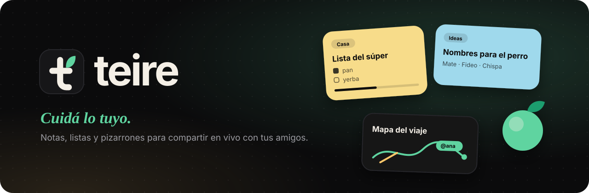

  
  
  
  

  
  

  <a href="https://useteire.app"><b>useteire.app</b></a> &nbsp;·&nbsp;
  <a href="#lo-que-hace"><b>Lo que hace</b></a> &nbsp;·&nbsp;
  <a href="#la-isla"><b>La isla</b></a> &nbsp;·&nbsp;
  <a href="#descargar"><b>Descargar</b></a> &nbsp;·&nbsp;
  <a href="#preguntas-frecuentes"><b>Preguntas</b></a>

  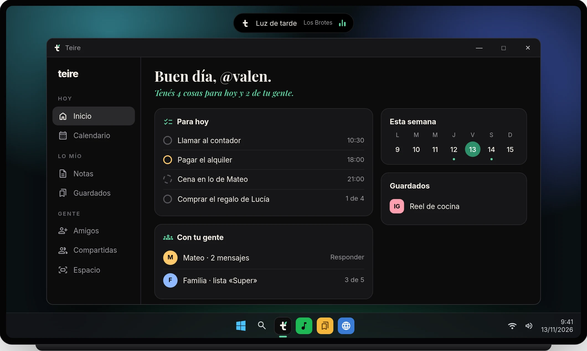

# Teire: tu día y el de tu gente, en un solo lugar

**Teire** es una **app gratis para organizar tu día y compartirlo con tus amigos**: tareas, recordatorios, calendario, listas que se completan en vivo, chat y una **isla** arriba de tu pantalla que guarda todo al toque. Para **Windows, Linux, Android e iPhone**. La hace un creador independiente en Argentina.

El nombre viene del japonés 手入れ (*teire*): cuidar y mantener algo con cariño, como a una planta. Por eso la hojita.

<table>
<tr>
<td width="33%" valign="top">

**Tu día** 
Tareas, recordatorios y calendario en un solo lugar, con modo foco para concentrarte.

</td>
<td width="33%" valign="top">

**Tu gente** 
Listas, chats y espacios que completás en vivo con tus amigos y tu familia.

</td>
<td width="33%" valign="top">

**Lo que guardás** 
Links, fotos y capturas quedan guardados en un gesto. Sin publicidad y sin internet también.

</td>
</tr>
</table>

## Lo que hace

<table>
<tr>
<td width="56%">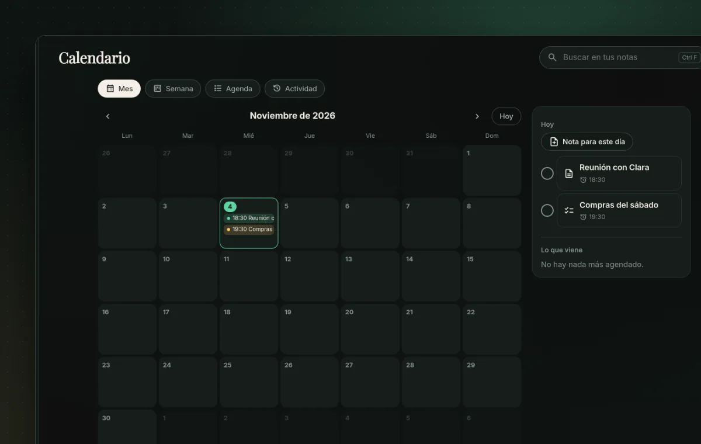</td>
<td width="44%" valign="middle">

### Tu día, en orden

**Para hoy** junta tus tareas, recordatorios y eventos en una sola lista, y te dice cuántas cosas tenés hoy y cuántas de tu gente. Calendario con **Mes, Semana y Agenda**. Los recordatorios llegan aunque cierres la ventana y se repiten hasta que les das **Listo**. Con el **modo foco** elegís en qué te concentrás y los avisos esperan.

</td>
</tr>
<tr>
<td width="44%" valign="middle">

### Tu gente, en vivo

Compartí una lista o una nota por su `@usuario` y mirá cómo la completan, letra por letra. **Con tu gente** te muestra los mensajes por contestar, las listas compartidas que avanzan y quién está en línea. El **pizarrón** es un lienzo a pantalla completa: ves lo que dibujan los demás mientras lo dibujan.

</td>
<td width="56%">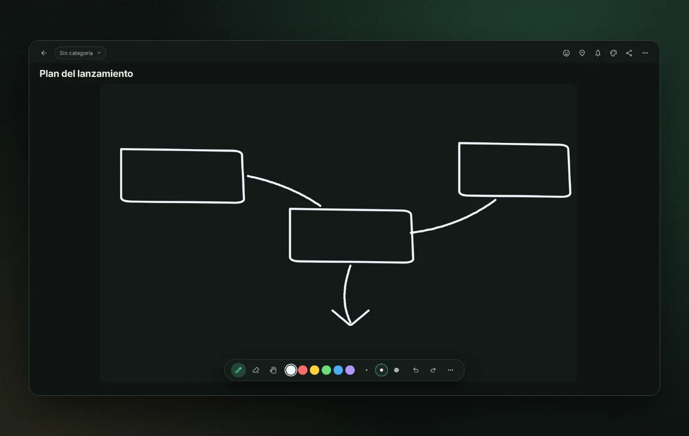</td>
</tr>
<tr>
<td width="56%">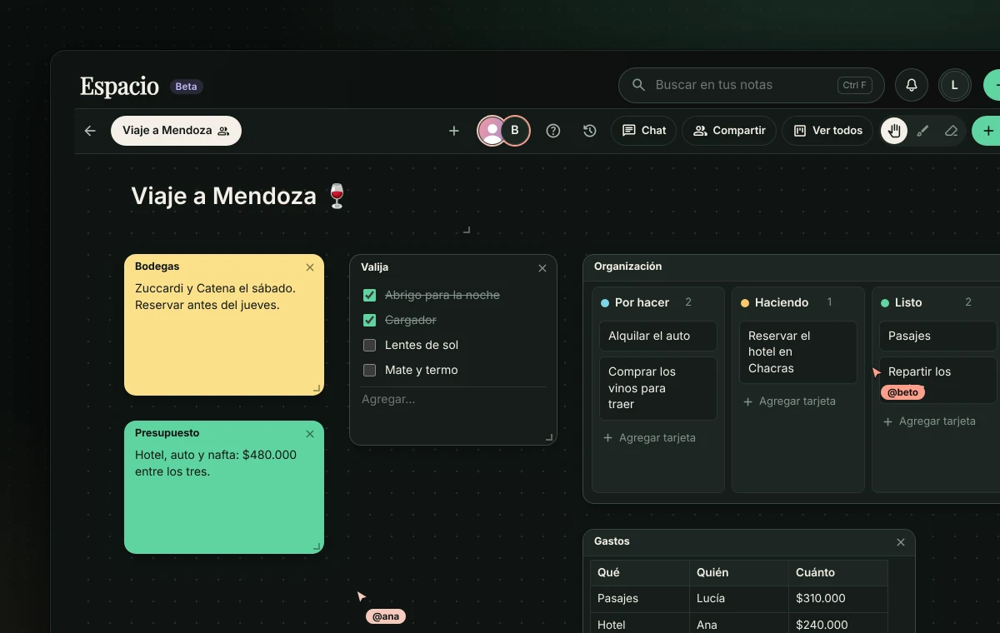</td>
<td width="44%" valign="middle">

### El Espacio

Un lugar para tu grupo: una lona con **notas, archivos, kanban, tablas, calendario y pizarrones**, chat y mouses en vivo. Si dos escriben a la vez, los cambios se juntan; y con el **historial** recuperás lo que se sacó. Invitá a quien quieras con un **link de 24 horas**, aunque no tenga Teire.

</td>
</tr>
<tr>
<td width="44%" valign="middle">

### Guardá al vuelo

Reels, videos, links, textos y capturas, agrupados por día. Pegá con `Ctrl+V` o arrastralo, y pasalo a una nota cuando quieras. En el celular, **Compartir → Teire** desde cualquier app.

</td>
<td width="56%">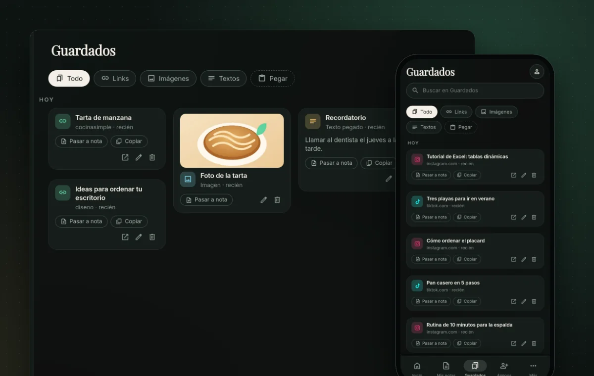</td>
</tr>
<tr>
<td width="56%">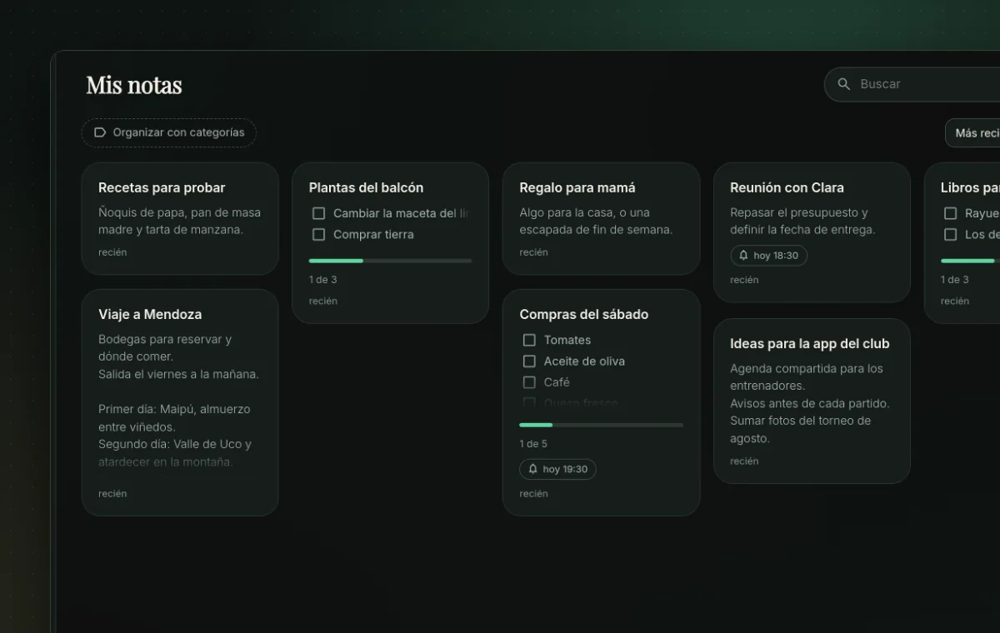</td>
<td width="44%" valign="middle">

### Y tus notas, a la vista

Notas, listas y pizarrones que se pintan con el **color de su categoría**. Las fijadas van arriba y cada tarjeta te dice cuánto falta de una lista o a qué hora es el recordatorio. Con imágenes, audios, lugares y `[[enlaces]]` entre notas.

</td>
</tr>
<tr>
<td width="44%" valign="middle">

### Pedíselo con la voz

En la compu decí **«Oye Teire»** (o apretá `Ctrl K`): *«creá una lista de compras con pan y leche»*, *«recordame mañana a las 9»*, *«mandale a Fede que llego tarde»*. Compartir una nota siempre te pide confirmar. Teire IA funciona **solo en español** por ahora.

</td>
<td width="56%">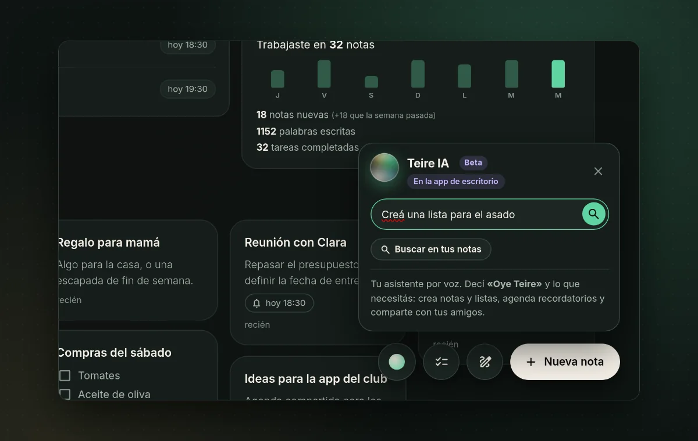</td>
</tr>
<tr>
<td width="56%">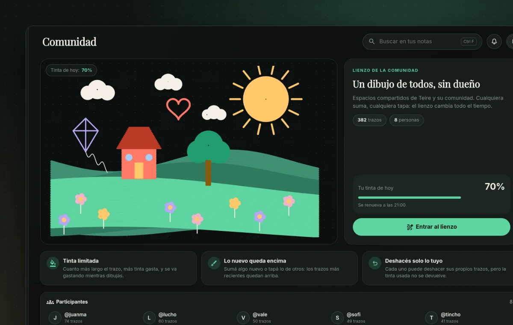</td>
<td width="44%" valign="middle">

### Comunidad

Un **lienzo compartido por todos**, sin dueño, estilo r/place: cada día tenés un poco de tinta para dibujar o tapar lo de otros. Ves quién participó y podés abrir su perfil.

</td>
</tr>
</table>

### Y además

<table>
<tr>
<td width="50%" valign="top">

**Chat, cartas e insignias.** Mensajes con fotos y notas adjuntas, responder un mensaje en particular y cartas con papel y animación. Insignias en tu perfil y tu estado: En línea, Ausente, No molestar o Invisible.

</td>
<td width="50%" valign="top">

**Tuyo y privado.** Notas con PIN cifradas en tu dispositivo: ni el servidor las puede leer. Funciona sin internet y sube todo cuando vuelve. Sin cuenta, tus notas quedan solo en tu equipo.

</td>
</tr>
</table>

## La isla

Una pastilla negra que vive arriba, al centro de tu pantalla (**Windows, con cuenta**). Estás viendo un reel, un artículo o una foto: lo arrastrás hasta ahí y **queda guardado**.

  

- **Arrastrás y soltás** un link, un texto o una imagen desde cualquier programa: la isla se abre para recibirlo.
- **Copiar = guardar:** copiás un link de Instagram, TikTok o YouTube y te pregunta si lo guardás, sin sacarte de lo que estás haciendo.
- **Capturas:** copiás una captura y te ofrece guardarla.
- **Te avisa** de mensajes y recordatorios ahí mismo, y podés **responder un mensaje desde la isla** sin abrir la app. Si algo quedó sin ver, se prende una lucecita verde.
- **Tu música** (Spotify, YouTube Music, Apple Music, Deezer, Tidal, VLC y otras apps de música) queda a la vista en la isla, con las barritas que bailan; pasás el mouse y aparecen **anterior, pausa y siguiente**, la **tapa del disco** y la **letra** al ritmo de la canción.
- **Pasás el mouse y se abre con pestañas:** lo que tenés hoy (con **«Entrar»** a tus videollamadas), tus recordatorios, tus amigos (**le escribís a quien quieras desde ahí**), tus notas, tus grupos y los avisos del día, todo sin abrir la app.
- **Modo foco:** elegís en qué te enfocás y por cuánto tiempo, y la isla te acompaña con el reloj. Si querés, los avisos esperan hasta que termines.
- **Notas pegadas al escritorio:** sacás una nota o una lista de la isla y queda flotando, como un post-it, para ir tachando.
- **Mandá cosas a tu celu:** un link, una foto o algo que copiaste te llega al celular en segundos.
- **Teire IA** te escucha y te contesta en la isla.
- Se esconde sola si estás en un juego o un video en pantalla completa.

## Teire Premium

Opcional, para quien quiere darle su toque.

  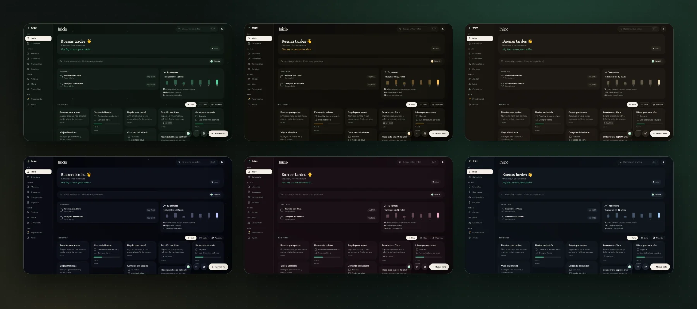

- **19 temas** para toda la app, en colecciones: Pastel, Vivos, Mundos y los hechos para Teire (**Jardín**, **Oro** y **Papel**). Sin Premium los podés **probar un minuto**.
- **El sello dorado:** la hojita de Teire en dorado, en tu chip y en el aro de tu foto.
- **Colores para tus notas**, para la isla y para el orbe de Teire IA, y la **isla de vidrio** o **pegada arriba**, como un notch.
- **El triple de pedidos** a Teire IA.

Se paga con **Mercado Pago** o **PayPal**, y **se lo podés regalar a un amigo** por 1, 3, 6 o 12 meses.

## Descargar

  <a href="https://useteire.app/#descargar"><b>Descargar desde useteire.app</b></a>

La página reconoce tu sistema y te da el instalador justo. Si preferís elegir el archivo a mano, están todos en la [última versión](https://github.com/codewtato/teire-descargas/releases/latest):

| Sistema | Archivo |
|---|---|
| **Windows 10 / 11** | `Teire_…_x64-setup.exe` |
| **Android** | [`Teire.apk`](https://github.com/codewtato/teire-descargas/releases/latest/download/Teire.apk) |
| **iPhone** | No lleva archivo: se instala desde Safari ([guía](https://useteire.app/iphone/)) |
| **Cualquier Linux** | `Teire_….AppImage` |
| **Fedora / openSUSE** | `Teire-….rpm` |

¿No querés instalar nada? [Usala en el navegador](https://useteire.app/app/) y entrá con tu cuenta, también con Google, Discord o GitHub. Ahí no están la isla ni la voz de Teire IA, y las notificaciones llegan con la pestaña abierta.

### Cómo instalar

<b>🪟 Windows</b>

1. Abrí el `.exe` que descargaste.
2. Si aparece **"Windows protegió tu PC"**, tocá **Más información → Ejecutar de todas formas**. Es normal en apps nuevas que todavía no tienen una firma paga.
3. Seguí el instalador. Teire queda en la bandeja y **se actualiza sola**.

<b>🤖 Android</b>

1. Descargá `Teire.apk` desde el celular y abrilo.
2. Android te va a pedir permiso para instalar apps de esta fuente: aceptalo.
3. Las próximas versiones se bajan e instalan desde la misma app.

<b>📱 iPhone</b>

Es gratis y no pasa por la App Store. Necesitás iOS 16.4 o más nuevo.

1. Abrí [useteire.app/app](https://useteire.app/app/) en **Safari**.
2. Tocá **Compartir** (en los iOS nuevos puede estar adentro de **···**), después **Agregar a Inicio** y **Agregar**.
3. Abrí Teire desde su ícono e **iniciá sesión ahí**: lo que hagas en Safari no pasa a la app instalada.
4. Tocá **Activar** para recibir notificaciones.

¿Entrás con Google, Discord o GitHub? Tocá **«Entrá con un código por correo»** y elegí una contraseña: es la misma cuenta.

Para guardar un link, copialo y tocá **Pegar** en Guardados. Si querés guardar desde Compartir sin abrir Teire, armá el atajo.

En iPhone no están la isla ni la voz de Teire IA. Todos los pasos, con el atajo y qué hacer si algo falla, están en la [guía de iPhone](https://useteire.app/iphone/).

<b>🐧 Linux</b>

- **AppImage:** `chmod +x Teire_*.AppImage` y abrilo con doble clic. Se actualiza sola.
- **Fedora / openSUSE:** `sudo dnf install ./Teire-*.rpm`.
- En **GNOME**, para ver el ícono en la bandeja necesitás la extensión [AppIndicator](https://extensions.gnome.org/extension/615/appindicator-support/).

## Preguntas frecuentes

<b>¿Teire es solo una app de notas?</b>

No: es un organizador. Tiene notas, pero también tareas, recordatorios, calendario, modo foco y todo lo que compartís con tu gente: listas en vivo, chat, grupos y espacios.

<b>¿Necesito una cuenta?</b>

No. Sin cuenta tus notas quedan solo en tu equipo. Con cuenta se sincronizan entre tus dispositivos y las podés compartir. Podés entrar con correo, Google, Discord o GitHub.

<b>¿Es gratis?</b>

Sí, y todo lo importante es gratis. Teire Premium es opcional: suma temas, el sello dorado, colores para tus notas y para la isla (también de vidrio), y más pedidos a Teire IA.

<b>¿Cómo invito a alguien a un Espacio?</b>

En tu Espacio tocá **Compartir** y creá un link. Quien lo abra entra sin cuenta y sin instalar nada. El link dura 24 horas y lo podés cerrar antes.

<b>¿Por qué Windows me muestra una advertencia?</b>

Porque el instalador todavía no tiene una firma de código paga, y Windows desconfía de las apps con pocas descargas. No significa que tenga un virus: con el tiempo la advertencia deja de aparecer.

<b>¿La isla funciona en Linux o sin cuenta?</b>

Por ahora no: la isla es solo para Windows y con cuenta (la creás gratis desde la app). El aviso de capturas sí funciona en Linux.

<b>¿Qué pasa con mis datos?</b>

Tus notas son tuyas. No hay publicidad ni vendemos datos. Las notas con PIN se cifran en tu dispositivo antes de subirse, y lo que arrastrás desde tu compu a una nota (salvo las imágenes) no se sube: queda solo el nombre. Está todo en la [política de privacidad](https://useteire.app/privacidad/).

<b>Encontré un problema o tengo una idea</b>

Contanos desde **Ayuda** dentro de la app o en [Issues](https://github.com/codewtato/teire-descargas/issues).

---

  © 2026 Teire. Argentina. 
  Este repositorio contiene los instaladores y el sitio <a href="https://useteire.app">useteire.app</a>; el código de Teire es privado. 
  <a href="https://useteire.app/privacidad/">Privacidad</a> · <a href="https://useteire.app/terminos/">Términos</a> · <a href="https://useteire.app/arrepentimiento/">Botón de arrepentimiento</a>

